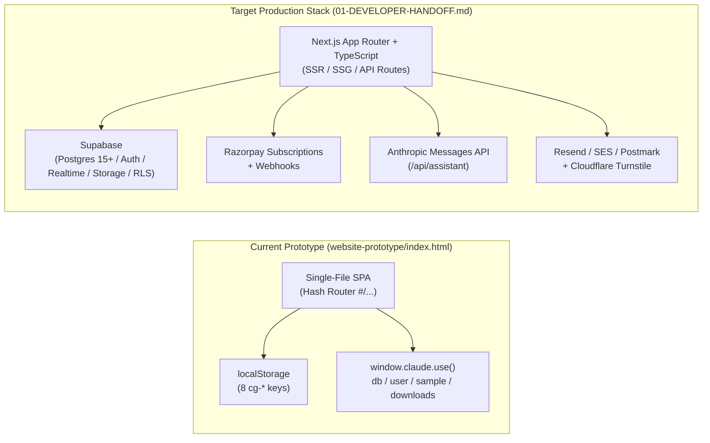

# Collabify Growth — Project Documentation

> **Status:** Pre-production Developer Handoff Kit (Interactive Prototype + Database Schema + Brand Assets + Production Spec)  
> **Kit Version:** 1.0 (October 2026)  
> **Primary Reference:** [`01-DEVELOPER-HANDOFF.md`](./01-DEVELOPER-HANDOFF.md)

---

## 1. What This Project Is

**Collabify Growth** (*Build. Distribute. Experience.*) is an integrated growth, technology, media, PR, founder operations, and events services company in India (`TEAM_SIZE = 42`, coordinated by one project lead per engagement).

This repository (`collabify-developer-kit`) is **not** a compiled production web application yet—there is no `package.json`, Node server, or Next.js codebase here. Instead, it is a complete **specification and working front-end prototype kit** containing:

1. A self-contained single-file SPA prototype ([`website-prototype/index.html`](./website-prototype/index.html)) built for visual, copy, UX, and functional parity.
2. A normalized PostgreSQL 15+ production schema ([`backend/database-schema.sql`](./backend/database-schema.sql)) and environment template ([`backend/.env.example`](./backend/.env.example)).
3. Brand logos, favicons, and design tokens ([`brand/`](./brand/)).
4. Developer requirements ([`01-DEVELOPER-HANDOFF.md`](./01-DEVELOPER-HANDOFF.md)) and an owner pre-launch content checklist ([`02-OWNER-CONTENT-CHECKLIST.md`](./02-OWNER-CONTENT-CHECKLIST.md)).

---

## 2. Repository Structure

| Path | Lines / Size | Purpose |
| --- | --- | --- |
| [`01-DEVELOPER-HANDOFF.md`](./01-DEVELOPER-HANDOFF.md) | 360 lines | Master build spec: recommended stack, 3-phase roadmap, route table, feature acceptance criteria, RLS matrix, SEO/WCAG/DPDP compliance. |
| [`02-OWNER-CONTENT-CHECKLIST.md`](./02-OWNER-CONTENT-CHECKLIST.md) | 100 lines | Business, legal, pricing, case-study, and account setup tasks required from the Collabify Growth owner before launch. |
| [`website-prototype/index.html`](./website-prototype/index.html) | 4,592 lines (~450 KB) | Complete HTML/CSS/JS SPA prototype with hash routing (`#/...`), 31 page handlers, 101 services, 4 free browser tools, AI assistant, blog, community chat, and admin inbox. |
| [`backend/database-schema.sql`](./backend/database-schema.sql) | 326 lines | PostgreSQL 15+ DDL: 24 tables, 7 enum types, 6 secondary indexes, and seed inserts for 7 community channels. |
| [`backend/.env.example`](./backend/.env.example) | 48 lines | Environment variable template covering site config, Supabase, transactional email, Razorpay, Anthropic AI, Turnstile, WhatsApp, GA4, Sentry, and affiliate tracking. |
| [`brand/brand-tokens.json`](./brand/brand-tokens.json) | 55 lines | Canonical light/dark color palettes, typography scale, border radii, and 7-color logo palette. |
| [`brand/`](./brand/) (images & SVGs) | 7 binary/SVG files | Wordmark+mark SVGs (`collabify-logo-dark-text.svg`, `collabify-logo-white-text.svg`), PNG mark/logo (`collabify-logo-original-white.png`, `collabify-mark-512.png`, `collabify-mark-full.png`), favicons (`favicon-32.png`, `favicon-180.png`). |
| [`docs/PROTOTYPE-REFERENCE.md`](./docs/PROTOTYPE-REFERENCE.md) | — | Deep-dive technical documentation of `website-prototype/index.html` (DOM, CSS tokens, JS data models, routing, modules, localStorage, accessibility). |
| [`docs/BACKEND-AND-MIGRATION.md`](./docs/BACKEND-AND-MIGRATION.md) | — | Deep-dive database reference, prototype-to-PostgreSQL collection mapping, RLS requirements, API contracts, and audit findings. |

---

## 3. Running & Previewing the Prototype

The prototype has **no build step**. You can inspect it in any modern browser:

```bash
# Option A: Serve locally over HTTP (recommended so clipboard/web APIs work in a secure context)
python3 -m http.server 8080
# Open http://localhost:8080/website-prototype/
```

Or open `website-prototype/index.html` directly in a browser (`file://`).

### What Works Out of the Box vs. What Requires Backend Services

| Feature Category | Runs Standalone in Browser? | Notes |
| --- | --- | --- |
| Marketing pages, capabilities, solutions, services search & shortlist, composer, carousel, light/dark theme, cookie banner | Yes | 100% client-side in `index.html`. |
| **4 Free Tools:** Media Kit Maker (`#/creators`), Event Invite Maker (`#/tools/invite`), WhatsApp QR Maker (`#/tools/whatsapp`), Growth Health Check (`#/health-check`) | Yes (with caveats) | Uses `localStorage`, `<canvas>` PNG export, URL-encoded state (`#/c/...`, `#/i/...`), and `qrcode-generator@1.4.4` from `cdnjs.cloudflare.com`. |
| **Ask Collabify AI Assistant** | Fallback only | Uses `window.claude.use('sample')` in Claude Artifacts; standalone browsers automatically fall back to `askLocal()` keyword/Hindi-English matching. |
| **Forms, Owner Inbox, Blog CMS, Community Chat, Affiliate & White-Label Portals** | No (disabled gracefully) | Depend on `window.claude.use('db')` and `window.claude.use('user')`, which are `null` outside Claude's artifact runtime. |

---

## 4. High-Level Architecture (Prototype vs. Target Production)



---

## 5. Business & Functional Scope

### Core Service Catalogue (101 Services)

All copy and service definitions live in the `CONTENT` `<script>` block of `website-prototype/index.html`:

| Capability ID | Slug | Name | Services |
| --- | --- | --- | ---: |
| `brand` | `brand-marketing` | Brand & Marketing | 25 |
| `tech` | `technology` | Technology | 15 |
| `media` | `media-content` | Media & Content | 12 |
| `pr` | `pr-reputation` | PR & Reputation | 10 |
| `fos` | `founder-os` | Founder OS | 10 |
| `events` | `events` | Events | 13 |
| `network` | `network-experiences` | Network & Experiences | 15 |
| `custom` | *(Across capabilities)* | Custom Integrated Growth & Technology Solutions (#101) | 1 |
| **Total** | | | **101** |

*(Note: Service #100 is `Collabify Distribution Marketplace`, marked `Planned`; `Owned Event IP Development` is marked `Coming soon`. Pending owner decision: adding SEO as service #102.)*

### Integrated Programmes (`PROGRAMMES`)

1. **Founder Growth** (`brand`, `media`, `pr`, `network`)
2. **Startup Launch** (`brand`, `tech`, `pr`)
3. **Event Growth** (`events`, `tech`, `network`)
4. **Digital Transformation** (`tech`, `brand`)
5. **Corporate Media** (`media`, `pr`, `network`)
6. **Founder OS Setup** (`fos`, `media`)
7. **Custom Solutions** (`#/solutions/custom`)

### Platform Portals & Tools

- **Lead Capture & CRM Inbox:** Start a Project form (`#/start-a-project`) with shortlist & programme prefill, DPDP consent checkboxes, and Owner Inbox (`#/inbox`) with KPI overview and 5-stage pipeline (`New` -> `Contacted` -> `Proposal sent` -> `Won` / `Lost`).
- **Paid Community:** Application (`#/community/join`), Razorpay membership plans (`Monthly` / `Annual`), 7 channels (`#/community/chat`), and searchable member directory.
- **Growth Programs:** 90-day first-touch Affiliate Program (`#/affiliates`, `#/r/:code`) and NDA-backed White-Label Agency Portal (`#/white-label`).
- **SEO Blog:** Category filtering, `BlogPosting` JSON-LD, admin Markdown editor (`#/blog/write`) with SERP preview and 10-point SEO checklist.
- **4 Free Acquisition Tools:** Growth Health Check, Media Kit Maker, Event Invite Maker, and WhatsApp QR Poster Maker—each carrying *"Made free with Collabify"* branding as a viral acquisition loop.

---

## 6. Production Delivery Roadmap

From [`01-DEVELOPER-HANDOFF.md`](./01-DEVELOPER-HANDOFF.md):

- **Phase 1 (Launch):** SSR/SSG public pages, Enquiry/Partner/Marketplace forms + transactional emails + Turnstile + DPDP `consent_log`, Role-protected `/admin` inbox & overview (2FA), SSR Blog + sitemap + admin editor, client-side Free Tools + `/c/[id]` & `/i/[id]` share links, Affiliate link attribution (`/r/[code]`), Ask Collabify `/api/assistant` route, SEO/WCAG 2.2 AA/Lighthouse targets.
- **Phase 2 (Accounts & Payments):** Community auth + Razorpay Subscription webhooks + Realtime chat/moderation, Affiliate commission/payout ledger, White-label portal with private Storage uploads + NDA + automated status emails, dynamic OG images for tools, optional WhatsApp/CRM sync.
- **Phase 3 (Platform):** Client project-tracking portal and Collabify Distribution Marketplace (service #100).

---

## 7. Key Gaps & Pre-Launch Blockers Identified

1. **Unfilled Owner Placeholders:** Copy in `index.html` contains `[square-bracket]` placeholders (rendered in dashed yellow `.ph` spans) for entity name, address, email, phone, city, response SLA, community pricing, affiliate commission/payouts, white-label pricing, 3 case studies, 6 client logos, testimonial, own events, and legal policies. All must be completed via [`02-OWNER-CONTENT-CHECKLIST.md`](./02-OWNER-CONTENT-CHECKLIST.md).
2. **RLS & Triggers Missing in SQL File:** [`backend/database-schema.sql`](./backend/database-schema.sql) defines tables, enums, and 6 indexes, but contains **no `ENABLE ROW LEVEL SECURITY`, no `CREATE POLICY` rules, and no `updated_at` triggers**.
3. **Hybrid SVG Brand Files:** [`brand/collabify-logo-dark-text.svg`](./brand/collabify-logo-dark-text.svg) and [`brand/collabify-logo-white-text.svg`](./brand/collabify-logo-white-text.svg) are 506 KB each because they trace the wordmark as `<path>` while embedding a raster `<image>` for the multi-color mark.
4. **Model ID Verification:** [`backend/.env.example`](./backend/.env.example) defaults `ANTHROPIC_MODEL=claude-haiku-5-5`; verify against live Anthropic API model identifiers during deployment.
5. **Client-Side Prototype Limitations:** Prototype relies on `localStorage` for referral attribution (`cg-ref`), URL base64 fragments for share links (`/c/:code`, `/i/:code`), and external CDN (`cdnjs.cloudflare.com`) for `qrcode-generator@1.4.4`.

---

## 8. Further Reading

- **[Prototype Technical Reference](./docs/PROTOTYPE-REFERENCE.md)** — Detailed guide to `website-prototype/index.html` internals, routes, CSS tokens, JS modules, and accessibility/security controls.
- **[Backend & Migration Guide](./docs/BACKEND-AND-MIGRATION.md)** — Detailed database schema documentation, prototype-to-Postgres mapping, environment configuration, API boundaries, and security checklists.

# collabify_growth
